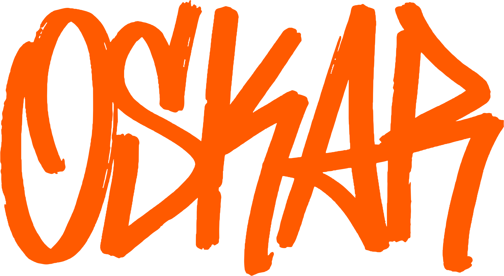
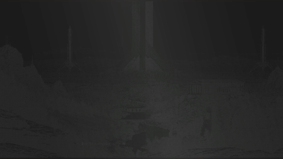

  

  I make launch films and product animation for software, and I build software myself. 
  Kielce, Poland. <b>Open to freelance work and internships.</b>

  <a href="https://oskarpajka.com"><b>Portfolio</b></a> &nbsp;/&nbsp;
  <a href="https://www.linkedin.com/in/oskarpajka/">LinkedIn</a> &nbsp;/&nbsp;
  <a href="https://x.com/pajkaoskar">X</a> &nbsp;/&nbsp;
  <a href="mailto:oskar@oskarpajka.com">oskar@oskarpajka.com</a>

---

## Software

| Project | What it is |
| --- | --- |
| [**framecatch**](https://github.com/Common-Branch/framecatch) | Screenshot and screen recording tool for Windows, built with a friend in Electron, React and TypeScript. |
| [**radiowezel**](https://github.com/vronadev/radiowezel) | Break music manager for my school's PA system and radio, built by a friend. I contribute to the codebase and am working on its front end. |

**Now:** learning Electron.

---

## Film

**Hoplite**, an independent concept film in After Effects, 2026. I rebuilt the interface so every part moves, animated every shot, and did the sound.

  

[**Watch the full film with sound**](https://oskarpajka.com)
